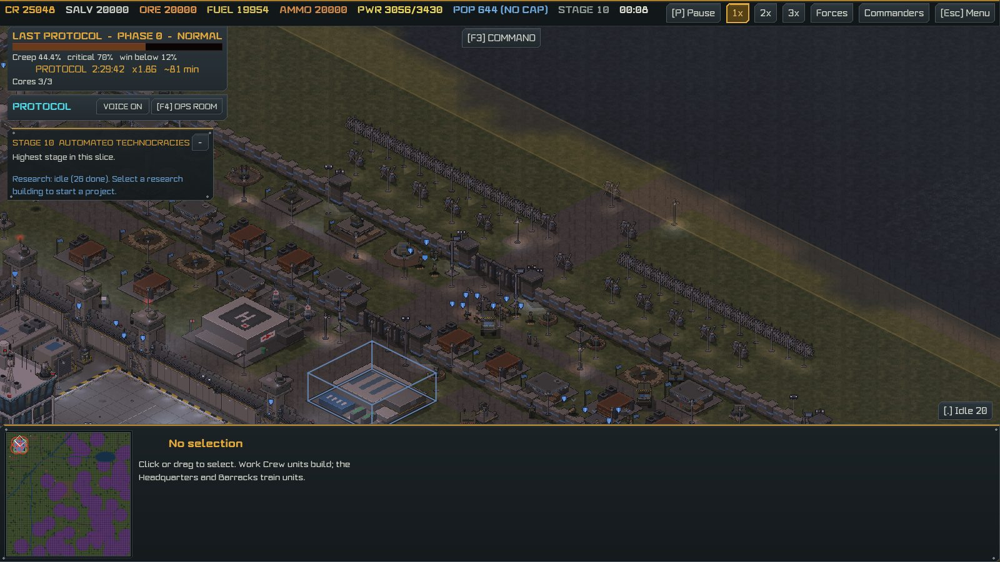
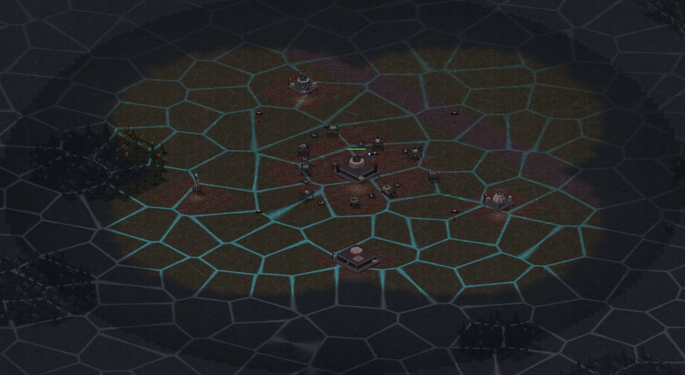
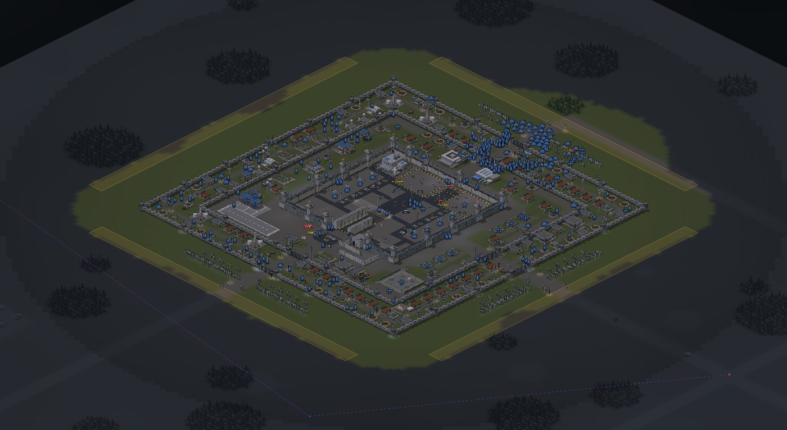

# RTS: Age of Modern War

Offline single-player real-time strategy in **Godot 4.7.2**, with a Rust native sim core. Classic skirmish plus a dedicated siege mode (**Last Protocol**). Tech climbs through **thirteen stages** (Age-of style eras): early recovery through modern combined arms into late synthetic forms.

Branch **`g71`**. Gates through **G7.1**, **G8**, **G9**, **Pre-G10**, and **G10 Shadow Coalition** are closed (`g10.lock`).

G10.1 stabilization is in progress. Coalition infantry and the six Coalition aircraft use their authored four-direction sprites in the battle view as the camera rotates. The eight-seat Stealth Transport can land, pick up infantry, deploy them at a new landing zone and return with them aboard. Coalition infantry switch to lowered NVGs at dusk and night, and the green laser appears in the firing pose. Ghost Infiltrators shimmer while concealed, and Counter-Ghost trackers and sensors can expose them nearby. The Silent Rotor visibly deploys its weapons when it first fires.

The 31 previously deferred Coalition vehicles and facilities have candidate art in the playable catalog. The Safehouse and concealed facilities show cover art until revealed to that player. Review the designs in [G10.1 deferred art candidates](game/docs/G10_1_DEFERRED_ART.md). Owner look approval is pending.

Use **Q / E** during a match to rotate the battlefield around the point under the camera. Terrain, fog and tactical markers follow the new view, and the minimap stays oriented to the map.

The G10.1 Machine and combat checks cover the hive roster and network, all 13 countermeasures, persistent terrain damage, vehicle recovery, siege skirmish and friendly-fire alerts.

Diplomacy now responds to Machine combat strength. AI adaptation gathers evidence from the side’s own combat history and losses.

Open **Coalition** in the match HUD for doctrine intent and Ghost Command. Scout an enemy structure, build a Ghost Complex and field four healthy Ghost operators to launch a ground mission. The Conductor issues orders and reports the outcome after extraction.

  

<em>Last Protocol — the fortress. Two rings. One facility. Hold it.</em>

  
  &nbsp;&nbsp;
  

<em>Dusk on the wire · core compound inside the inner wall</em>

---

## What this is

- **Skirmish** — pick faction, stage band, map, teams, and victory rules; fight up to three AI sides.
- **Last Protocol** — hold a fortified facility against an escalating Machine siege on its own map and ruleset (not a skirmish preset).
- **Long-term** — a chaptered campaign, underground expansion content, Living World, and later orbit/arrival content are planned; see below.

The game stays offline. Balance numbers in content JSON are provisional fixtures, not final.

### Gallery

| | |
|:--:|:--:|
|  <em>Main menu — Skirmish setup</em> |  <em>Skirmish — early match</em> |
|  <em>Last Protocol — belts under fire</em> |  <em>Siege line — outer ring</em> |

Captures are ~1600×900, compressed for GitHub. Prefer `docs/media/` when linking screenshots from this README.

---

## Skirmish

Open **Main menu → Skirmish**.

  

<em>Skirmish setup — map, sides, economy, and victory in one pass.</em>

### Factions (playable now)

| Faction | Role |
|---|---|
| **Human A** | Modern military combined arms |
| **Human B** | Industrial / salvage power |
| **Machine** | Autonomous energy-bound network |

Additional factions unlock through later development and play; this README does not list unreleased or discovery-gated identities.

### Stages / tech eras

There are **thirteen stages**. In the current build, sides typically start in the **mid–late band** (roughly Stages **7–10**): research mid-match and advance when stage gates are met. Earlier and later stage bands for existing factions are planned for a later slice; a forthcoming faction ships its own full 1–13 band when that gate lands.

### Setup (high level)

- **2–4 sides** — You / AI / Closed; faction, team, colour, starting credits, AI difficulty
- **Teams or free-for-all** — allies share vision
- **Economy profile** — arcade / standard / simulation
- **Maps** include River Crossing (96²), Industrial Heartland (160²), Valley Conquest (256²); custom maps from the editor can be selected when saved
- **Victory modes** — HQ elimination, territory control, hold-the-bridge, Endless, or combined AND/OR rules
- Optional **adaptive Machine director** toggle on setup; capped siege units accept attack-move

### What a match includes

Economy (salvage/ore, power flow, supply), build/train, fog of war, armour classes, wrecks, walls/gates, air and naval layers, companies/armies and chain of command, EW, field forts, vehicle crews/wear, and AI that pays the same costs and only knows what it sees. Full system history lives under `game/docs/` and older slice notes in `game/README.md`.

  

<em>In match — resources, stage goals, and the first footprint on the map.</em>

---

## Last Protocol

Somewhere under the map, a clock is still counting. Nobody who wrote the Protocol is left to explain what happens at zero. You get one night. Maybe two if you steal the dark and make it yours.

  

<em>Outer ring — walls, pads, and the wire you inherit.</em>

### The ground you inherit

You don't drop into an empty sandbox. You inherit a living fortress already under pressure:

- **Two rings of wall** — outer kill-zone and a hard **core** around the heart of the base.
- Between them: the economy that keeps guns fed, pads hot, and wounded moving.
- At the centre: the **facility** — command, labs, workshops, pads on the roof, doors that open into a war that never clocks out.
- Gates with approach belts. Cameras on the corners. Helipads already loaded. An army on the wire — and a reserve held back behind the last wall, because someone before you knew the first wave is never the real one.
- On the far horizon: **Machine cores**. Kill them and the tide can break. Fail, and the count finishes what the hive started.

The clock starts at **dusk**. Night lasts longer than day here. When the lights die down to searchlights and muzzle flash, the map stops being a map and starts being a confession.

### On the ground

<table>
  <tr>
    <td align="center" width="33%"> <em>Something spreads.</em></td>
    <td align="center" width="33%"> <em>Nodes wake.</em></td>
    <td align="center" width="33%"> <em>Hold the ring.</em></td>
  </tr>
</table>

### Why you fight

The hive is not a faction. It is a *process*. Creep eats the land. Nests pulse. Something in the dark adapts to how you hold a wall, how you rotate a sector, how you panic. It will feint. It will learn your weak face. It will climb its own dead if that is what the wall demands.

You are not here to farm a leaderboard. You are here because if this ring falls, there is no next ring.

### What you actually do

Hold. Rotate. Fall back only when the Protocol would rather you live than die proud on a cracked rampart. Strike the cores when the night opens a seam. Spend what the siege pays you — scrap, captured steel, intel, research scratched out under fire — without a tutorial telling you which door is mercy and which is a trap.

There are tools. Loyal robots that refuse the hive's handshake. Eyes that see what camo thinks is invisible. Fire that redraws the approaches. A war-mind you can lie to. Conduct that costs more than ammo. None of them come with a ribbon that says *press this to win*. The game wants you hungry. It wants you wrong once, then dangerous forever.

  

<em>Night line — formations on the belts while the Protocol still counts.</em>

### The part we won't spoil

There are things in the tide with names you will earn the hard way. There are endings that change what dawn means. There is a reason the Protocol is called *Last* — and the only way to learn it is to still be standing when the count runs out… or to watch the facility go quiet and know exactly what you traded.

**Main menu → Last Protocol.** Bring a pulse.

---

## Campaign (planned)

Working title: **Inheritance**. Vision is recorded in `game/docs/CAMPAIGN_VISION.md` (not contracted build scope yet; roadmap places it as a later gate).

Public shape only:

- **Thirteen chapters**, one per stage — from scattered survivors through modern war into late synthetic eras
- **Founder lifetime** early, then **heir generations**
- **Regional map hub** (real-time, pausable) with authored operations; every battle is played in the same RTS sim
- **Carry-over** — scars, people, grudges, builds
- **Story** (retry) and **Dynasty / Ironman** modes
- Roughly **60–80 hours** targeted across the arc
- After the finale: an endless **Living World** on the same save

Story twists, secret identities, and chapter beats stay out of this README. **Last Protocol stays a separate mode** from the campaign Machine war.

---

## Addons / expansions (roadmap)

Not shipped. High-level only, from the owner-approved roadmap (`game/docs/ROADMAP.md`):

| Track | What it is |
|---|---|
| **UNDERSTRIKE** | Human A–only underground bunkers, floors, borers, and later networked underground civilization (multi-phase) |
| **All Thirteen** | Early (1–6) and late (11–13) stage parity for factions that still lack those bands |
| **Inheritance** | The 13-chapter campaign above |
| **Living World** | Post-campaign endless dynasty / continental layer |
| **Orbit / arrivals** | Space tier and further factions after Living World |
| **Last Protocol co-op** | Offline-first 2–4 player siege on the same LP ruleset; solo LP stays the 1v1 reference |

Treat these as a shipping pipeline, not a storefront promise. Each gate still gets its own frozen Done-when before build.

---

## Development pipeline

### Shipped (orientation)

G0 engine → G1 core RTS → G2 smart warfare → G3a/G3b factions, stages 7–9, maps → G4 editor / walls / scale → G5 air/naval/hospitals/tutorial → G6 elevation, companies, marketplace → G6.1 field command → **G7 Last Protocol** → **G7.1** Tide Line siege depth → **G8** Four Sides view rotation + end-of-run presentation → **G9** Machine overhaul + combat depth → **Pre-G10** AI/economy depth bridge → **G10** Shadow Coalition (closed).

### In this G10 build (summary)

- **Shadow Coalition** fourth faction: Stages 1–13, buy/steal/unseal tech, Ghost Exo + Exo Armory, Counter-Ghost Corps, dark picks, Coalition LP defender profile
- Pre-G10 stack retained: Four Sides, HIVE9/COUNT9/COMBAT9/AI9/ECON9, Warmind, PACE71
- ART approved-core locked (CELL / DEATH / WALKER / CLOSE AIR); TECHNICAL / SAFEHOUSE / HATCH owner-deferred
- Lock evidence: smoke **122/0**, stage hashes MATCH; see `.superpowers/sdd/g10.lock`

### Next gates (planned order)

| Gate | Headline (public) |
|---|---|
| **G11–G13** | UNDERSTRIKE foundation → military → networked underground |
| **G12** (with soldiers/theatres) | Human depth, biomes/modes; optional uncapped skirmish population |
| **G14** | Remaining factions’ Stages 1–6 and 11–13 |
| **G15** | Campaign *Inheritance* |
| **G16–G17** | High-fidelity underground; Living World |
| **G18** | Orbit / arrival expansion |
| **G19** | Last Protocol co-op |

Detail and acceptance live in `game/docs/ROADMAP.md`. Design contracts and older slice evidence: `game/docs/CONTRACTS*.md`, `game/README.md`.

---

## Play the packaged build

Latest Windows package (auto-refreshed every ship):

`Downloads\Age of Modern War\RTS_Age_of_Modern_War_G71_*`

**Package size (latest build):** 282 MB unpacked · 180 MB zip — `RTS_Age_of_Modern_War_G71_2026-11-24_5f55236c` (295539045 bytes folder / 188419151 bytes zip).

Keep these three together:

- `RTS_Age_of_Modern_War.exe`
- `RTS_Age_of_Modern_War.pck`
- `rts_core.dll`

Double-click the exe. Main menu → **Last Protocol** or **Skirmish**.

Also in that folder: `PLAY_ME.txt`, look-checkpoint strips under `G71_LOOK_CHECKPOINT/`, and a matching `.zip` beside the folder.

### From source (dev)

- Godot **4.7.2**
- Open `game/`, or run `game/run.bat` (Windows) / `bash game/run.sh`
- Install tip: `winget install GodotEngine.GodotEngine --version 4.7.2`, or set `GODOT` to your exe

Useful launcher flags (append): `--autostart`, `--autostart-seed=N`, `--autostart-factions=human_a,human_b,machine`, `--autostart-map=<id>`, `--player-ai`, `--speed=8`.

---

## How to fight

- Select: click, drag, shift, double-click. Right-click is the smart order.
- Hotkeys: **A** attack-move, **S** stop, **H** hold. Ctrl+1–9 control groups. **Q / E** (or horizontal middle-mouse drag) rotate the view 90°.
- **Ctrl+M** — minimal Last Protocol HUD.
- Save / load: F5 / F9 (or pause menu).

---

## Branch & verify

- Active branch: `g71` (`g10.lock` CLOSED)
- Ship path: commit → push `github` → `game/.plan/package_g71.ps1` → playable folder + zip in Downloads (keeps the newest 2). Build tag embeds the short git hash.
- Smoke: `powershell -File game/tools/g71_donewhen_smoke.ps1`
- Short soak: `godot --headless --path game -s res://tools/g71_soak_short.gd -- --secs=90`
- Tests from source: `bash game/tests/run.sh`

---

## Docs map

| Doc | Use |
|---|---|
| This file | Public overview for GitHub |
| `game/README.md` | Historical playable-slice notes (G0–G7.1 era) |
| `game/docs/ROADMAP.md` | Full gate order to finished game |
| `game/docs/CAMPAIGN_VISION.md` | Campaign / Living World / space vision (spoiler-heavy — for contributors who need it) |
| `game/docs/understrike/` | UNDERSTRIKE design handoff |
