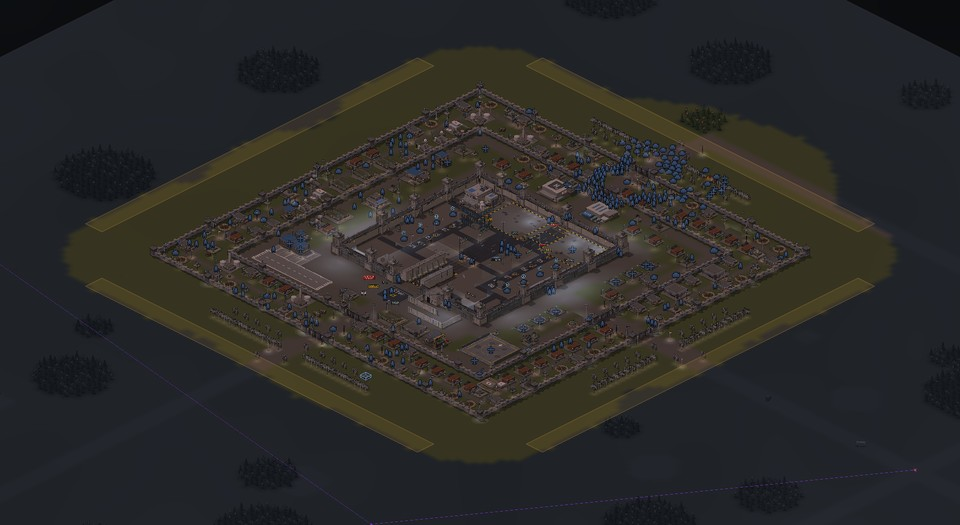
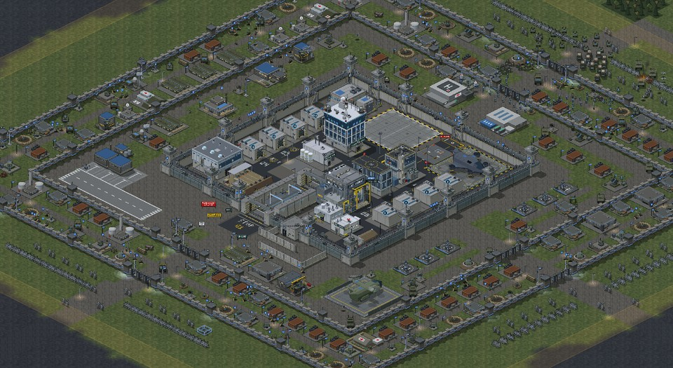
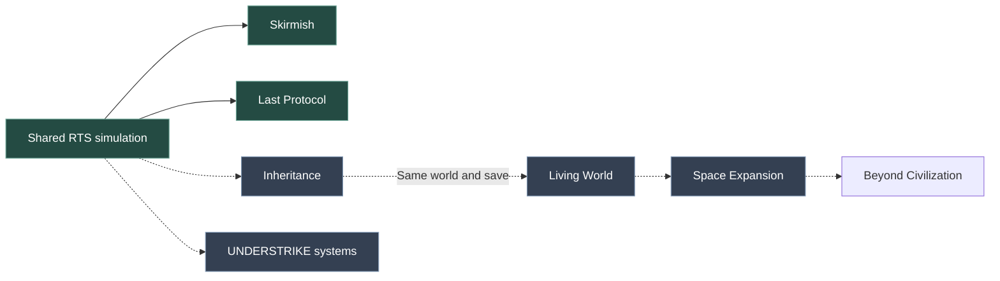
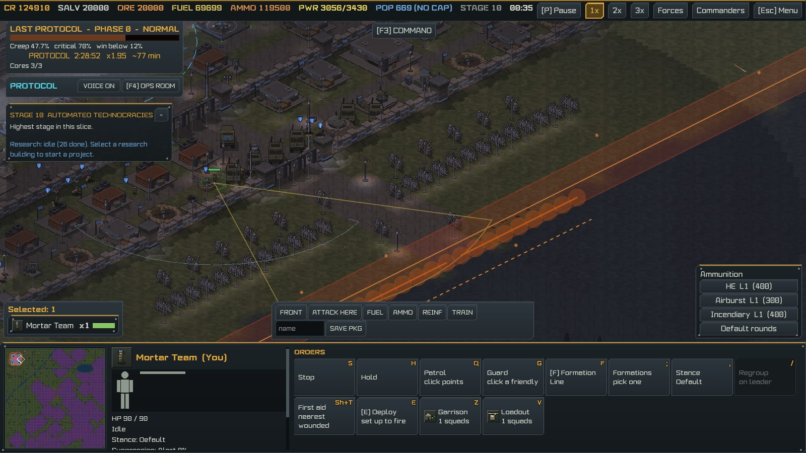
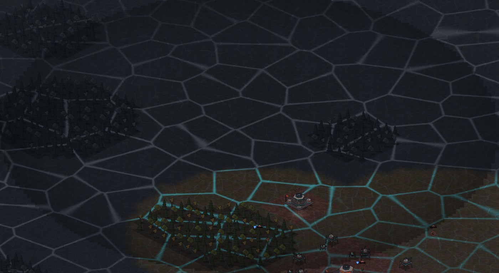
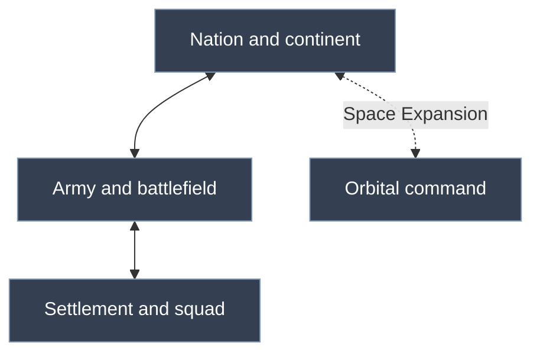
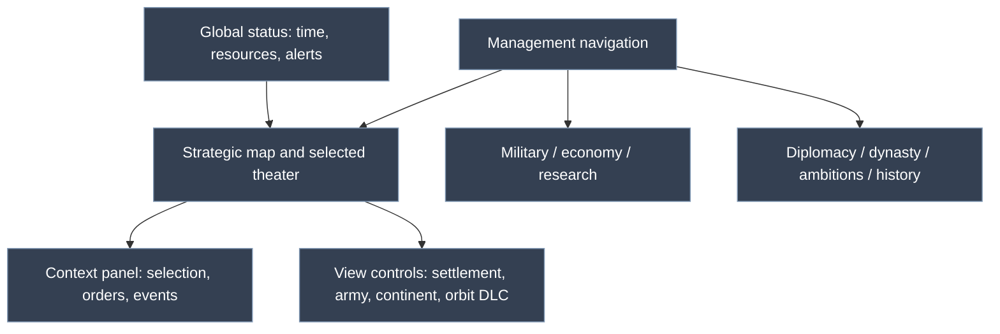
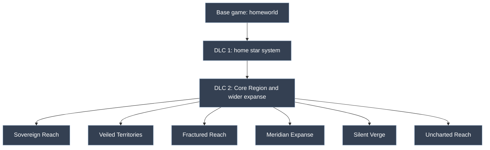
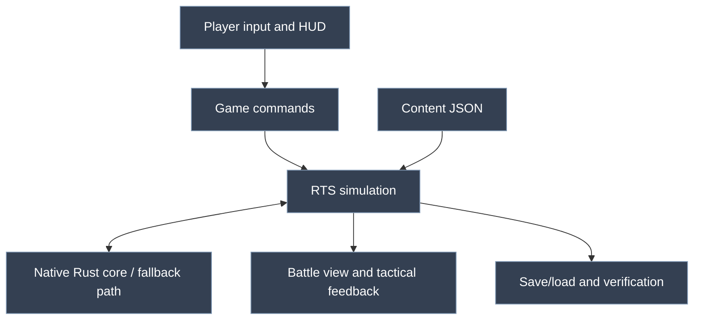

# RTS: Age of Modern War

[](https://godotengine.org/)
[](#play-the-packaged-build)
[](https://github.com/loganlewisw1112-create/Age-of-modern-war/tree/g71)
[](#development-status)
[](#development-status)

**Build a military civilization. Command its armies. Survive an enemy that adapts.**

Age of Modern War is an offline, single-player real-time strategy game built in **Godot 4.7.2** with a native **Rust simulation core**. It brings together civilization-scale technological progression, combined-arms warfare, asymmetric factions, autonomous military command and persistent battlefield systems.

From improvised settlements to advanced military-industrial powers, thirteen technological stages define a world in which the weapons, institutions and consequences of war evolve together. Fight customizable battles today; the longer-term vision extends into generational campaigns, underground civilization, a persistent continental sandbox and warfare beyond Earth.

<p align="center">
  
</p>
<p align="center"><em>Last Protocol — the fortress. Two rings. One facility. Hold it.</em></p>
<p align="center">
  
  &nbsp;&nbsp;
  
</p>
<p align="center"><em>Dusk on the wire · core compound inside the inner wall</em></p>

[Play](#play-the-packaged-build) · [Skirmish](#skirmish) · [Factions](#factions-playable-now) · [Last Protocol](#last-protocol) · [Inheritance](#inheritance--campaign) · [Living World](#living-world) · [UNDERSTRIKE](#understrike) · [Space Expansion](#space-expansion) · [Beyond Civilization](#beyond-civilization--DLC-2) · [Roadmap](#development-status) · [Developer guide](#technical-architecture)

---

## One simulation. Distinct experiences.

| Experience | What you do | Status |
|---|---|---|
| **Skirmish** | Build, research, command and defeat rival factions on customizable battlefields. | Playable |
| **Last Protocol** | Hold an inherited fortress against an escalating Machine siege. | Playable |
| **Inheritance** | Guide a civilization through thirteen chapters and successive generations. | Planned |
| **Living World** | Shape an enduring world of autonomous civilizations after the campaign. | Planned |
| **UNDERSTRIKE** | Build and defend an underground military-industrial civilization. | Planned base-game addition |
| **Space Expansion (DLC 1)** | Extend civilization into one home star system. | Planned DLC |
| **Beyond Civilization (DLC 2)** | Explore a finite authored interstellar expanse with autonomous alien civilizations. | Approved design; not implemented |



*Solid connections represent current playable modes; dashed connections describe planned development. UNDERSTRIKE is a planned integrated base-game addition, not DLC.*

## Core gameplay systems

| System | Current documented capabilities |
|---|---|
| Economy and industry | Salvage, ore, power flow, supply, construction, training, research, trade and marketplaces |
| Combined arms | Infantry, armored vehicles, aircraft, surface fleets, submarines, carriers, drones and EW |
| Military organization | Companies, armies, officers, command hierarchy, suppression, fatigue and veterancy |
| Battlefield simulation | Armor classes, facing, ballistics, component damage, wrecks, persistent terrain damage and elevation |
| Logistics and support | Vehicle crews, wear, recovery, medical support, field fortifications and defensive infrastructure |
| Autonomous opposition | Fog-limited AI, Machine adaptation, diplomacy and strategic decision-making |
| Intelligence | Reconnaissance, concealment, counter-detection and Coalition operations |
| Presentation | Day/night, four-sided camera rotation, tactical markers and end-of-run presentation |
| Customization | Scenario editor, configurable teams, economy profiles, victory conditions and save/load |

Balance figures in content JSON are provisional. Current documented systems remain subject to regression testing and refinement.

### Gameplay gallery

| | |
|:--:|:--:|
| <br><em>Skirmish setup</em> | <br><em>Early match</em> |
| <br><em>Belts under fire</em> | <br><em>Outer ring</em> |

Existing gameplay captures are approximately 1600×900, compressed for GitHub. Future faction and expansion showcases should use actual repository-generated assets or clearly labeled concept art.

---

## Skirmish

**Main menu → Skirmish.** Create a war on your own terms. Choose your faction, opponents, starting stage, map, economy and victory conditions. Develop an economy, establish military infrastructure, research technology and command forces across land, sea and air.

<p align="center">
  
</p>
<p align="center"><em>Map, sides, economy and victory in one pass.</em></p>

### Factions (playable now)

| Faction | Identity | Doctrine |
|---|---|---|
| **Human A — Modern Human** | Advanced military civilization | Combined arms, hierarchical command, autonomous robotics, counter-nanite and Counter-Ghost capabilities |
| **Human B — Scavenger Human** | Industrial and salvage-oriented civilization | Recovered resources, industrial strength and massed armor and artillery doctrine |
| **Machine** | Autonomous energy-bound hive | Networked growth, creep, adaptive warfare, siege units and battlefield consumption |
| **Shadow Coalition** | Covert and asymmetric power | Concealed infrastructure, Ghost Exo operators, intelligence, technology acquisition and patron contracts |

Unreleased and discovery-gated campaign identities remain undisclosed.

### Human A — Modern Human

**Professional combined arms, advanced engineering and coordinated military command.**

Modern Human is the faction for players who want to build a modern military force rather than simply assemble an army of individual units. Its doctrine emphasizes reconnaissance, coordinated formations, specialized support and the ability to bring land, air and naval forces together under a common command structure.

Its economy relies on gathering salvage and ore, maintaining power and supply, and investing in production and research. Infantry, armored vehicles, artillery, aircraft, naval assets and autonomous robotics provide complementary battlefield roles. Companies, armies and officers help organize larger forces, while engineers, supply vehicles, medical support and field fortifications sustain operations beyond the starting base.

Human A also has specialized counter-nanite and Counter-Ghost capabilities for confronting the Machine and concealed Coalition operators. In Last Protocol, its military infrastructure and counter-nanite force support the defense of the inherited fortress. In Skirmish, its defining challenge is coordinating a sophisticated military while protecting the infrastructure and logistics that keep it operational.

**Playstyle:** Establish a reliable industrial and defensive foundation, build balanced formations, and use reconnaissance, electronic warfare and specialized support to maintain battlefield initiative. Advanced units are most effective as part of a coordinated force, not as isolated weapons.

### Human B — Scavenger Human

**Industrial resilience, recovered machinery and the weight of mechanized warfare.**

Scavenger Human approaches civilization through recovery and industrial strength. Where Modern Human emphasizes sophisticated combined-arms coordination, Human B builds its identity around salvaged resources, rugged equipment and the ability to turn recovered material into fighting power.

The Salvage Yard provides its distinctive economic foundation. Tough infantry, rebuilt tanks and artillery trucks form the core of its documented military identity, supported by the game's wider research, production, logistics and field-command systems. Its massed armor and artillery doctrine favors sustained pressure and the concentration of industrial firepower rather than relying exclusively on highly specialized forces.

A Human B army still needs supplies, protected infrastructure and appropriate support. Recovered equipment and industrial production do not eliminate the need to maintain vehicles, defend resource access or adapt to enemy air power, electronic warfare and changing battlefield conditions.

**Playstyle:** Develop a strong salvage and production economy, protect the flow of resources, and assemble durable mechanized forces capable of maintaining pressure across contested territory. Human B rewards players who enjoy industrial expansion, armored formations and sustained conventional warfare.

### Machine — Autonomous Network

**An energy-bound synthetic civilization that grows, adapts and consumes the battlefield.**

The Machine is not a conventional human army with a different appearance. Its units operate through an autonomous network, depend on energy and recharge near hubs, and do not use human morale. Creep, hive infrastructure and networked growth give it a fundamentally different military and economic identity.

Its forces include combat drones, walkers, artillery nodes and specialized siege units. The G9 overhaul expands its hive network, adaptive evolution, blended visual identity and battlefield consumption systems. Wrecks and contested terrain matter to the hive, while the optional adaptive Machine director brings additional siege pressure into Skirmish. AI adaptation uses observed combat history rather than assuming perfect knowledge of the enemy.

The Machine is designed to be powerful without being invulnerable. Its network, energy supply and expansion can be contested through the game's documented thirteen-countermeasure framework, including electronic warfare, relay disruption, material denial and counter-nanite systems. Last Protocol presents a dedicated escalating hive siege; playing Machine in Skirmish is a distinct competitive sandbox experience.

**Playstyle:** Establish and maintain the network, sustain energy access, expand hive influence and combine specialized synthetic units to pressure opponents. Exploit opportunities to grow while protecting the infrastructure on which the force depends.

### Shadow Coalition

The fourth faction ships a full Stage 1–13 progression, with **61 documented gameplay definitions**, six distinct aircraft and 31 formerly deferred vehicle and facility art assets approved on November 26, 2026. [Approved art and repository-generated review sheets](game/docs/G10_1_DEFERRED_ART.md).

Coalition infantry and aircraft use authored four-direction sprites. Infantry lower NVGs at dusk and night; firing uses the green laser pose. Ghost Infiltrators shimmer while concealed, Counter-Ghost trackers and sensors can reveal them nearby, and Silent Rotor deploys its weapons when it first fires. The eight-seat Stealth Transport supports landing, boarding, deployment and extraction. Concealed facilities retain per-viewer cover appearances until revealed.

Open **Coalition** in the match HUD for doctrine intent and Ghost Command. Scout an enemy structure, build a Ghost Complex and field four healthy Ghost operators to launch a ground mission. The Conductor issues orders and reports the outcome after extraction. The Advanced panel offers four dark operations, technology acquisition and patron contracts. Blackout temporarily interrupts power and production in the target area.

### Match customization

| Setting | Options |
|---|---|
| Sides | 2–4; player, AI or closed slots; faction, team, color, starting credits and AI difficulty |
| Teams | Allied shared vision or free-for-all |
| Economy | Arcade, standard or simulation |
| Maps | River Crossing (96²), Industrial Heartland (160²), Valley Conquest (256²), saved custom maps |
| Victory | HQ elimination, territory control, hold-the-bridge, Endless or combined AND/OR rules |
| Machine pressure | Optional adaptive Machine director; capped siege units accept attack-move |

### Technology progression

Human A, Human B and Machine currently focus on roughly Stages 7–10, with research and stage-gated advancement. Shadow Coalition ships Stages 1–13. Remaining early and late stage parity is planned for G14.

<p align="center">
  
</p>
<p align="center"><em>Resources, stage goals and the first footprint on the map.</em></p>

---

## Last Protocol

Somewhere under the map, a clock is still counting. Nobody who wrote the Protocol is left to explain what happens at zero. You get one night. Maybe two if you steal the dark and make it yours.

<p align="center">
  
</p>
<p align="center"><em>Outer ring — walls, pads, and the wire you inherit.</em></p>

### The ground you inherit

You don't drop into an empty sandbox. You inherit a living fortress already under pressure:

- **Two rings of wall** — outer kill-zone and a hard **core** around the heart of the base.
- Between them: the economy that keeps guns fed, pads hot, and wounded moving.
- At the centre: the **facility** — command, labs, workshops, pads on the roof, doors that open into a war that never clocks out.
- Gates with approach belts. Cameras on the corners. Helipads already loaded. An army on the wire — and a reserve held back behind the last wall, because someone before you knew the first wave is never the real one.
- On the far horizon: **Machine cores**. Kill them and the tide can break. Fail, and the count finishes what the hive started.

The clock starts at **dusk**. Night lasts longer than day here. When the lights die down to searchlights and muzzle flash, the map stops being a map and starts being a confession.

### On the ground

<table>
  <tr>
    <td align="center" width="33%"><br><em>Something spreads.</em></td>
    <td align="center" width="33%"><br><em>Nodes wake.</em></td>
    <td align="center" width="33%"><br><em>Hold the ring.</em></td>
  </tr>
</table>

### Why you fight

The hive is not a faction. It is a *process*. Creep eats the land. Nests pulse. Something in the dark adapts to how you hold a wall, how you rotate a sector, how you panic. It will feint. It will learn your weak face. It will climb its own dead if that is what the wall demands.

You are not here to farm a leaderboard. You are here because if this ring falls, there is no next ring.

### What you actually do

Hold. Rotate. Fall back only when the Protocol would rather you live than die proud on a cracked rampart. Strike the cores when the night opens a seam. Spend what the siege pays you — scrap, captured steel, intel, research scratched out under fire — without a tutorial telling you which door is mercy and which is a trap.

There are tools. Loyal robots that refuse the hive's handshake. Eyes that see what camo thinks is invisible. Fire that redraws the approaches. A war-mind you can lie to. Conduct that costs more than ammo. None of them come with a ribbon that says *press this to win*. The game wants you hungry. It wants you wrong once, then dangerous forever.

<p align="center">
  
</p>
<p align="center"><em>Night line — formations on the belts while the Protocol still counts.</em></p>

### The part we won't spoil

There are things in the tide with names you will earn the hard way. There are endings that change what dawn means. There is a reason the Protocol is called *Last* — and the only way to learn it is to still be standing when the count runs out… or to watch the facility go quiet and know exactly what you traded.

**Main menu → Last Protocol.** Bring a pulse.

---

## Inheritance — Campaign

> **Thirteen chapters. Two centuries of civilization. One dynasty.**

*Planned single-player campaign · 13 technological eras · 60–80 hours targeted gameplay. The approximate 200-year chronology and public chapter titles below are proposed, not locked production scope.*

The old world is gone. Its cities stand empty, its infrastructure falls silent, and the survivors must decide what deserves to be rebuilt.

You begin with almost nothing: a handful of people willing to follow you, a winter to survive, and a world that no longer owes anyone a future.

Across generations, establish settlements, reclaim industry, raise armies, defend your homeland and confront powers that grow alongside you. Every victory changes the world. Every defeat leaves a scar. The people you protect and the enemies you create shape a future you may never live to see.

Your descendants inherit everything. Including your mistakes.

### The passage of history

| Chapter | Era | Proposed year after collapse | Since previous chapter |
|---|---|---:|---:|
| I — The Last Dawn | Scattered Survivors | 0 | — |
| II — The Camp | Organized Camps | 1 | 1 year |
| III — Valley of Reclamation | Pioneer Settlements | 4 | 3 years |
| IV — Reclamation | Reclamation Townships | 9 | 5 years |
| V — The Confederacy | Workshop Confederacies | 17 | 8 years |
| VI — Smoke and Iron | Industrial Revival | 30 | 13 years |
| VII — Steel Tide | Mechanized States | 45 | 15 years |
| VIII — Nations | Modern Nations | 60 | 15 years |
| IX — The Shadow of Power | Networked Powers | 80 | 20 years |
| X — The Network | Automated Technocracies | 105 | 25 years |
| XI — Flesh and Lattice | Synthetic Civilizations | 130 | 25 years |
| XII — The Weight of Empires | Distributed Civilizations | 160 | 30 years |
| XIII — Apex | Apex Civilizations | 200 | 40 years |


The early chapters are personal: scarcity, survival and the creation of a home. Later chapters span decades, as responsibility passes from the founder to successive generations. The dates describe proposed chapter start points, not fixed real-time mission lengths.

### Chapter I — The Last Dawn
*Stage 1 · Scattered Survivors · Year 0 — The Collapse*

The final days of the old world give way to the first winter of the new one. Lead a small band through abandoned settlements, recover essential supplies and defend the people who have placed their lives in your hands. There is no nation coming to rescue you, no army waiting beyond the horizon.

**Pivotal struggle:** Survive the first winter and establish a permanent community. Scavenging, shelter and small-unit combat introduce the foundations of the campaign.

### Chapter II — The Camp
*Stage 2 · Organized Camps · Year 1 — One year later*

Shelters become permanent structures. Scavengers become specialists. Volunteers begin forming the first organized military units. But beyond your perimeter, a rising warlord is gathering power, and the community you built has become worth taking.

**Pivotal conflict:** Defend your independence in the first organized struggle between survivor communities. Establish production, defenses and a force capable of protecting more than its own camp.

### Chapter III — Valley of Reclamation
*Stage 3 · Pioneer Settlements · Year 4 — Three years later*

Your people can no longer live behind one perimeter. Push into the valley, establish farmland and settlements, cross contested rivers and protect the convoys connecting them. When a community comes under attack, its evacuation becomes your responsibility. Beyond familiar roads, abandoned places wait in silence.

**Pivotal conflict:** Secure the valley's resources and transportation corridors while keeping vulnerable outlying communities alive. The regional map becomes increasingly important.

### Chapter IV — Reclamation
*Stage 4 · Reclamation Townships · Year 9 — Five years later*

Nearly a decade after the collapse, the ruins of industrial civilization offer a chance to restore reliable electrical power. A dam and power plant stand between your townships and a future beyond scarcity. Fight across contested infrastructure as a storm threatens to change the battlefield itself.

**Pivotal conflict:** Reclaim the dam and power infrastructure in a defining authored operation. The environment is as consequential as the opposing force.

### Chapter V — The Confederacy
*Stage 5 · Workshop Confederacies · Year 17 — Eight years later*

The communities you once struggled to feed have become functioning townships. Workshops produce machinery, militias become organized forces, and independent settlements begin to unite. The children who grew up during the collapse are becoming engineers, officers and leaders. A young officer represents the generation that will inherit this world.

**Pivotal moment:** Unite the townships and establish institutions that can survive beyond the founding generation. The question is no longer whether your community can survive, but whether it can endure.

### Chapter VI — Smoke and Iron
*Stage 6 · Industrial Revival · Year 30 — Thirteen years later*

A new generation takes command. Factories dominate the skyline, roads connect distant communities, and industrial production transforms the scale of military power. Beyond your borders, Human B rises with an industrial strength capable of challenging everything your predecessors established.

**Pivotal conflict:** Rival industrial powers compete for territory, resources and influence. Coastal warfare, manufacturing and organized logistics broaden the struggle.

### Chapter VII — Steel Tide
*Stage 7 · Mechanized States · Year 45 — Fifteen years later*

The trenches where your ancestors once fought with improvised weapons now shake beneath armored columns. Tanks, mechanized infantry and artillery formations redefine the battlefield. A force that cannot secure fuel, ammunition and its route home cannot sustain an offensive.

**Pivotal conflict:** The first mechanized war with Human B, fought over familiar terrain transformed by decades of construction and destruction. Command companies, maintain vehicles and coordinate sustained operations.

### Chapter VIII — Nations
*Stage 8 · Modern Nations · Year 60 — Fifteen years later*

Six decades after the collapse, nations again command the land, sea and sky. Modern armored formations, aircraft, naval fleets and logistical networks transform warfare. Your homeland must withstand the pressure of sophisticated rival powers while unfamiliar threats emerge beyond established frontlines.

**Pivotal conflict:** A modern war that challenges conventional military superiority. Coordinate combined arms and blue-water naval capabilities across widening theaters.

### Chapter IX — The Shadow of Power
*Stage 9 · Networked Powers · Year 80 — Twenty years later*

Warfare extends beyond the borders marked on a map. Surveillance, electronic warfare and specialist operators become essential as rival powers compete for technological dominance. The most heavily defended territory can still be vulnerable, and the most dangerous threats need not announce themselves.

**Pivotal conflict:** An increasingly unconventional struggle for strategic and technological advantage, where control of information matters as much as control of ground.

### Chapter X — The Network
*Stage 10 · Automated Technocracies · Year 105 — Twenty-five years later*

More than a century has passed since the first survivors gathered. Advanced military complexes, autonomous robotics and interconnected industries sustain sophisticated armies. The Machine now threatens civilization across multiple fronts. Cities may fall while your forces are committed elsewhere.

**Pivotal conflict:** Open regional Machine war. Full RTS base-building battles, preparatory operations and linked engagements determine which fronts can be held. This is a separate conflict from Last Protocol.

### Chapter XI — Flesh and Lattice
*Stage 11 · Synthetic Civilizations · Year 130 — Twenty-five years later*

Prolonged warfare is transforming humanity itself. Advanced robotics and synthetic technologies offer capabilities earlier generations could never imagine. As the conflict intensifies, the distinction between biological capability and engineered power grows less certain.

**Pivotal conflict:** An escalating war of technological adaptation. Decide how far your civilization is willing to transform itself to survive, without abandoning the people it was built to protect.

### Chapter XII — The Weight of Empires
*Stage 12 · Distributed Civilizations · Year 160 — Thirty years later*

Your ancestors built a camp. You command a civilization. Interconnected territories, advanced industries and distributed military infrastructure sustain enormous strategic responsibilities. Yet old grievances, internal tensions and competing powers can threaten even the strongest military.

**Pivotal conflict:** A civilization-wide crisis challenges the unity, legitimacy and military strength of your dynasty. The consequences of generations converge.

### Chapter XIII — Apex
*Stage 13 · Apex Civilizations · Year 200 — Forty years later*

Two centuries after the collapse, the descendants of scattered survivors command technological power beyond anything their founders could have imagined. Familiar battlefields carry the scars of generations. The conflicts that shaped your civilization reach their culmination.

**Pivotal conflict:** The final struggle to determine the future of the civilization you built. You began by fighting to survive another winter. Now you fight to determine what civilization becomes.

### How the campaign plays

- **One persistent homeland:** a hand-crafted regional map, with expeditions to other theaters. The world is fixed in geography but dynamic in its events, rivalries and consequences.
- **Every battle is played:** authored operations and regional engagements use the shared RTS simulation. No battle delegation or auto-resolution during the campaign.
- **Evolution by era:** Chapters I–IX emphasize growing settlements; Chapters X–XIII unlock full RTS base-building battles. Large engagements can be shaped by preparatory and concurrent operations.
- **Years-pass interludes:** establish policies, prepare successors and witness births, deaths and border changes between chapters.
- **Named people:** officers rise from soldiers; experience, wounds, relationships and inherited loyalties matter. The founder leads I–V; heirs lead VI–XIII.
- **Persistent consequences:** destroyed bridges, scarred terrain, settlements, reputations and grievances survive the battles that created them.
- **Adaptive war director:** changes pressure, enemy moves, refugee events, weather windows and recovery periods between authored story beats.
- **Research:** rediscover lost technology, choose exclusive research branches and study captured equipment.
- **Military logistics:** orders travel by courier or radio according to era and distance; disconnected armies continue their last orders. Supply, weather and terrain shape operations.
- **Conduct:** how you treat civilians and opponents influences future cooperation and resistance.
- **Presentation:** in-engine cinematics, voiced radio, illustrated story panels, adaptive music and returning battlefields.

Early chapters target roughly 1–2 hours; later chapters may exceed 8–10 hours. Total target is approximately 60–80 hours, subject to production and testing.

| Mode | Experience |
|---|---|
| **Story** | Retry operations and maintain multiple saves. |
| **Dynasty / Ironman** | One autosave per dynasty; losses persist and alter later starting conditions. |

The campaign has an authored chapter structure. Its outcomes and deeper discoveries remain intentionally undisclosed. After the campaign, the same world can continue in Living World.

---

## Living World

> **History no longer follows a script.**

*Planned post-campaign civilization sandbox. Core systems are grounded in the design vision; detailed management interfaces below are proposed and not yet implemented.*

The campaign may end. Civilization does not.

Its cities, armies, military installations, battlefields and rival powers remain. Continue leading your dynasty or begin a new legacy in the world it shaped. There are no predetermined chapters and no final mission waiting to be completed. You are one civilization among many, each pursuing its own future.

### A world that develops without you

Autonomous civilizations grow, decline and compete independently. Rivals establish settlements, develop their military capacity, pursue ambitions and respond to crises. A powerful nation may fracture; a weakened rival may recover. Any civilization, including yours, can regress technologically.

The world is dynamic rather than a sequence of authored chapter states. Each world stands alone: a completed save does not become the hidden history of a different playthrough.

### Command at multiple scales

| View | Player responsibilities |
|---|---|
| **Settlement / squad** | Local infrastructure, production, defensive positions, specialist squads and small operations |
| **Army / battlefield** | Direct RTS command of companies, armies, aircraft, fleets and autonomous systems |
| **Nation / continent** | Territorial development, simultaneous fronts, military assignments, diplomacy and logistics |
| **Orbit** | Aerospace infrastructure and fleets, available through the planned Space Expansion |



These are connected strategic scales, not a promise of seamless zoom or direct first-person control.

### Military high command and delegated operations

Unlike the campaign, you are no longer required to personally fight every engagement. Assign armies strategic responsibilities and allow officers to oversee operations while you manage another front. Intervene through the RTS battlefield when an engagement demands your attention.

Develop commanders and military organizations whose capacity matters beyond your own micromanagement. Protect supply networks, defend regions, conduct territorial campaigns and reorganize after defeats. Delegation and resolution mechanics remain subject to final implementation design.

### Dynamic diplomacy and geopolitics

Living World introduces persistent, systemic, war-first diplomacy rather than exclusively story-driven campaign relationships. Negotiate treaties, ceasefires, alliances, tribute, vassal relationships and trade pacts. Respond to betrayals, historical grievances and changes in military power.

A former enemy may become a valuable partner; a trusted ally may become a rival. The system is not intended to become a deep trade simulator or a parliamentary voting game.

### Industrial civilization and technological regression

Grow settlements into towns, industrial cities and advanced urban centers. Establish manufacturing, research and military infrastructure, secure resources and protect the routes connecting them. The visual character of cities should reflect their construction history, industry and wartime damage.

Losing the foundations of technological power can reverse progress. Rebuild damaged infrastructure, reconstitute military forces and recover from a civilization-wide setback rather than restarting a match.

### Leadership, memory and succession

Develop successors and commanders, preserve institutional knowledge and respond to competing ambitions within your civilization. The succession panel records the current ruler, living heirs, traits, wounds, mentors and previous rulers. Named officers and rival generals remember previous encounters.

The land carries its history. Memorials, ruined districts and returning battlefields record the cost of war. A legacy ledger tracks accomplishments, casualties, battles and the reputation of your civilization across generations.

### Dynamic crises and ambitions

World crises may destabilize multiple powers at once, reshuffle alliances or create opportunities far from your borders. Famine, disease, military emergencies and resurgent threats are examples of planned crisis types.

Set ambitions instead of following a fixed mission list: unify a continent, rebuild devastated cities, preserve a dynasty, defeat a persistent rival or prepare an aerospace program when the expansion becomes available. Milestones, rewards and contextual events provide direction without imposing a predetermined ending.


### Proposed strategic interface

Living World deserves a dedicated civilization-management interface rather than a larger Skirmish HUD. The proposed layout keeps the strategic map central, with persistent civilization status, management navigation and contextual events.



*Conceptual UI architecture, not a screenshot or approved visual specification.*

| Proposed interface | Function |
|---|---|
| Civilization dashboard | National resources, population, development, infrastructure and alerts |
| Strategic world map | Borders, settlements, military theaters and contextual map layers |
| Military high command | Armies, commanders, assignments and operational status |
| Settlement manager | Local construction, production and defenses |
| Logistics network | Supply routes, shortages and infrastructure connections |
| Diplomatic command | Treaties, alliances, tribute and vassal relationships |
| Research directorate | Research priorities, advancement and recovered technology |
| Dynasty and succession | Ruler, heirs, traits, mentors and historical leadership |
| World events | Crises, geopolitical developments and military reports |
| Ambitions | Long-term goals, milestones and progress |
| Historical ledger | Campaigns, casualties, accomplishments and legacy |
| Orbital command | Space installations, fleets and logistics with the DLC |

### What is unique to Living World?

| Capability | Skirmish | Last Protocol | Inheritance | Living World |
|---|---|---|---|---|
| Shared RTS combat | Yes | Yes | Planned | Planned |
| Persistent civilization across generations | — | — | Planned | Planned |
| Authored chapter progression | — | — | Planned | — |
| Direct battle command | Yes | Yes | Planned | Planned |
| Delegated campaign-scale battles | — | — | — | Planned |
| Persistent autonomous civilization growth | — | — | Limited by story | Planned |
| Systemic civilization-level diplomacy | Match-level only | — | Story-driven | Planned |
| Continental management | — | — | Regional hub | Planned |
| Dynamic world crises and ambitions | — | — | Story/director events | Planned systemic layer |
| Technological regression across generations | — | — | — | Planned |
| Endless historical sandbox | — | — | — | Planned |
| Orbital expansion | — | — | — | Planned DLC |

In Inheritance, you experience history. In Living World, you create it.

---

### Next-generation living simulation (approved design)

The Campaign and Living World are designed around **deep simulation underneath, classic RTS simplicity on top**. People, cities, industries, military institutions and rival civilizations operate autonomously; the player builds, explores, researches and commands with familiar RTS controls, taking direct control or delegating routine responsibilities whenever appropriate.

Four coordinated directors share a single persistent world state:

| Director | Purpose |
|---|---|
| Dynamic World | Unpredictable, causally grounded discoveries, environmental events, crises and opportunities |
| Geopolitical | Independent governments, diplomacy, alliances, rivalries and shifting power |
| Historical & Generational | Persistent people, institutions, battlefields, succession and historical consequences |
| Faction Evolution | Distinct civilization development, research specialization and military adaptation |

Planned simulation depth includes organic city growth, autonomous civilian routines, physical manufacturing and supply chains, functioning military installations, transport networks, component damage, emergency response and reconstruction. Contextual animations and spatial audio make real activity visible without changing the established art style. Familiar build/train/research orders drive the underlying systems automatically; optional panels expose details, not required chores.

Campaign retains authored milestones and personally played battles; Living World unlocks delegated battles and unrestricted emergent history. Adaptive simulation detail and persistent identities are intended to support large worlds offline; actual scale and hardware performance remain subject to validation. These are owner-approved design additions, not shipped features or release promises. Every system must demonstrably improve gameplay without increasing mandatory player complexity.

## UNDERSTRIKE

> **Civilization does not stop at the surface.**

*Planned integrated base-game addition, not DLC · Human A track · G11–G13 foundations and G16 high-fidelity work.*

The surface battlefield is only one layer of the war. UNDERSTRIKE introduces a military-industrial domain beneath it: excavated facilities, vertically connected infrastructure, underground logistics and subterranean defense.

Establish a bunker foundation with a planned 15-floor architecture, modular facilities, cameras, concealed service elevators and automated management. Extend underground operations through military boring fleets, underground security, surface connections and eventually networked bunker cities.

Excavation is intended to be an engineering and economic problem, not a decorative building placement. Materials, time, energy, geology and structural conditions constrain construction. Reuse excavated material, transport supplies and develop specialized production and research beneath the surface.

| Development phase | Intended capability |
|---|---|
| Foundation | Modular multi-floor bunkers, service connections, cameras and automated management |
| Military | Boring fleets, security, underground combat and surface breakthroughs |
| Network | Interconnected bunker cities, transportation and specialized research/materials |
| High fidelity | Geology, structural destruction, hybrid engineering and scale optimization |

The simulation is intended to use hierarchical detail and persistence rather than arbitrary building-count promises. Practical scale remains subject to engineering validation. [Design handoff](game/docs/understrike/).

---

## Space Expansion

*DLC 1 · Owner-approved planned design · G19 · Not implemented.*

**True Dynasty:** Inheritance → Living World → Space Expansion → Beyond Civilization. One earned civilization history, with progression prerequisites, accumulated wars, discoveries, commanders, technologies, infrastructure and political consequences. Separate new saves allow seamless preset or customized starts in either owned DLC with coherent initialized history; they never alter Dynasty. Existing campaign battle rules remain. New DLC factions playable only in Skirmish.

### The original home star system

Asterion (working name): twelve original planets, 48 individually identified moons, five dynamic asteroid belts. Existing campaign homeworld lore preserved; fictional celestial geography replaces literal Solar System assumptions. Realistic scale, stable orbits, atmospheric and geological conditions, rotation, tides, eclipses, radiation, ecosystems and physical travel require scientific validation. Gas and ice giants have no playable solid surface.

| Planet | Moons | Gameplay |
|---|---:|---|
| Veyra | 0 | Scorched metal extraction and heat-resistant industry |
| Ignaris | 1 | Volcanic metallurgy and geothermal energy |
| Homeworld | 2 | Existing civilization and aerospace capital |
| Thalora | 2 | Ocean cities and aquatic industry |
| Kharon | 3 | Heavy industrial and military civilization |
| Nythera | 2 | Exotic minerals and experimental science |
| Vesperon | 12 | Gas giant harvesting and orbital megastructures |
| Cryovex | 3 | Frozen industry and subsurface oceans |
| Orynth | 11 | Ice giant atmosphere and remote logistics |
| Vaelith | 4 | Exotic biology and biotechnology |
| Erevos | 5 | Ancient structures and archaeology |
| Noxaris | 3 | Remote expeditions and mysteries |

Ember Belt, Iron Expanse, Shattered Ring, Crystal Drift and Outer Veil offer finite mining, collisions, salvage, anchored bases and contested logistics. Most moons specialize in industry, military or science, not mandatory large settlements.

### Seven gameplay phases

1. **Race to Orbit:** aerospace knowledge, launch infrastructure and sustainable orbital operations.
2. **Orbital Supremacy:** stations, shipyards, factories, defenses and physical cargo fleets.
3. **Lunar and Asteroid Expansion:** personally establish mining, science and military bases, then appoint commanders.
4. **Age of Discovery:** exotic materials, reverse engineering, new technology and optional mysteries.
5. **Interplanetary Civilization:** autonomous colonies, cities, trade and industrial networks.
6. **War for the Star System:** fleet, orbital, atmospheric, ground, aquatic, underground and boarding operations; existing arrival war preserved.
7. **Beyond the System:** advanced propulsion, massive engineering and readiness for DLC 2. DLC 1 remains independently playable indefinitely.

These are nonlinear capabilities, not new civilization stages or mandatory quests.

### Space industry and extraordinary technology

Fifteen proposed fictional materials unlock 13 technology branches through research, extraction, refining and production. Original mining ships, autonomous drones, atmospheric harvesters, mobile refineries, landers, rovers, construction ships, freighters, colony vessels, research craft, military fleets and support ships. New functional command buildings, orbital factories, shipyards, cities, fortresses, megastations, feasible elevators and stellar collectors. Actual resource, energy, engineering and transportation constraints; no crafting micromanagement.

### Autonomous Space Command

Build personally with familiar RTS controls, then appoint commanders and delegate operations. Nine directives: Balanced, Expansionist, Industrial, Military, Offensive, Defensive, Scientific, Economic and Custom. Competence, experience, doctrine, limited knowledge, actual supplies and delegated authority shape autonomous outcomes. Take direct control and resume autonomy whenever permitted. Physical logistics, military campaigns and environmental emergencies handled automatically with actionable alerts.

### A living star system

Interactive 3D stellar navigation connects planetary, orbital, regional and tactical views. Shared persistent resources, casualties, infrastructure, territory and history. Solar events, collisions, storms, discoveries, depletion, independent colonies, political shifts and industrial breakthroughs arise from causal state. Hierarchical simulation preserves physical scale without full-detail processing everywhere. Fully offline.

### The Hidden Chronicle

Optional discoveries, unexplained signals and ancient mysteries can arise through player actions, rival civilizations and natural events. Some never activate. Knowledge spreads with delays, and consequential choices permanently shape future civilization history and DLC 2 encounters. Existing campaign secrets remain protected. No mandatory quest grind or predetermined outcome.

**Specifications:** [SPACE EXPANSION GDD](game/docs/SPACE_EXPANSION_GDD.md) · [STELLAR SYSTEM BIBLE](game/docs/STELLAR_SYSTEM_BIBLE.md) · [EXOTIC RESOURCE BIBLE](game/docs/EXOTIC_RESOURCE_BIBLE.md) · [SPACE TECHNOLOGY ARCHITECTURE](game/docs/SPACE_TECHNOLOGY_ARCHITECTURE.md) · [DYNAMIC SPACE ENVIRONMENT](game/docs/DYNAMIC_SPACE_ENVIRONMENT.md) · [AUTONOMOUS SPACE COMMAND](game/docs/AUTONOMOUS_SPACE_COMMAND.md) · [SPACE EXPANSION DELIVERY PLAN](game/docs/SPACE_EXPANSION_DELIVERY_PLAN.md). Internal narrative specification may contain spoilers.

### Space warfare and fleet command

Command fleets with specialized spacecraft, escorts, support vessels and massive capital ships. The visual goal is epic scale, with original faction-specific designs rather than borrowed ship identities. Fleet composition, logistical support and named crews matter.

| Public faction | Internally designed hull roster | Fleet identity |
|---|---:|---|
| Modern Human | 21 | Advanced modern military navy |
| Scavenger Human | 22 | Heavy armored industrial fleet |
| Machine | 24 | Synthetic networked swarm fleet |
| Shadow Coalition | 22 | Asymmetric, covert and contracted naval power |

These are design-roster figures, not implemented spacecraft counts or guaranteed release scope.

### Boarding and connected warfare

Take operations inside spacecraft and orbital installations through squad-based close-quarters combat using the established tactical and casualty systems. Space is not a disconnected game: ground infrastructure supports orbital fleets, orbital assets affect terrestrial warfare, and both layers depend on industrial and technological capacity.

### People, colonies and the next generation

Named crews develop space-specific experience and traits. Off-world settlements may develop independent ambitions. A dynasty can eventually rule from orbit, while continuing to manage the world that enabled its ascent.

The road to orbit depends on the world inherited from Inheritance and Living World. Its pace depends on your civilization and rival powers. The deeper narrative, hidden discoveries and outcomes are intentionally undisclosed.

---

## Beyond Civilization — DLC 2

> **Beyond the home system. Beyond the civilizations we know.**

*Owner-approved expansion design · Not implemented · G20 · Release date unassigned.*

Beyond Civilization extends the same persistent world into a finite, authored interstellar expanse. The primary True Dynasty path begins in the Core Region with the civilization inherited from the base campaign, Living World and DLC 1; separate independent starts are also supported. Where Space Expansion (DLC 1) opens the home star system, DLC 2 opens the rest of the Core and six surrounding regions. The intended experience combines the freedom of space exploration, the mystery of isolated worlds and the danger of a lawless expanse with the familiar build, command and fight loop of Age of Modern War.

**The geography is authored. The history is dynamic. The gameplay remains RTS.** No endless procedural galaxy, mandatory ship piloting, diplomatic paperwork or colony micromanagement.

### I — Beyond the Home System

Develop interstellar propulsion and the infrastructure to sustain expeditions beyond familiar territory. Your campaign outcome directly determines the forces, technology, resources, settlements, alliances, rivalries and crises with which you begin. Existing saves carry forward; purchasing the expansion opens its content without granting free ships or bypassing technological prerequisites.

Select a destination and dispatch a fleet, or take direct command. Autonomous crews handle navigation, refueling, repairs, resupply and escorts. Discover distress signals, abandoned ships, hidden stations, hostile fleets and unexpected opportunities along the route. Trade corridors and gateways can develop, become contested or collapse.

### II — The Interstellar Expanse

Explore a target of **50 authored star systems across seven regions**, including the original home system. Each has a distinctive geographical foundation and history; political borders, military activity and economic conditions change autonomously. The planning range is 40–60 systems, subject to content and performance validation.

| Region | Systems (baseline) | Character |
|---|---:|---|
| Core Region | 5 | Home system and neighboring stars; familiar starting territory, never permanently safe |
| Sovereign Reach | 10 | Established powers, major cities, military and industrial centers |
| Veiled Territories | 9 | Isolated civilizations, exotic environments and limited contact |
| Fractured Reach | 7 | Contested colonies, pirates, mercenaries and independent settlements |
| Meridian Expanse | 8 | Resource-rich worlds, mining, trade and colonial competition |
| Silent Verge | 5 | Ancient ruins, abandoned infrastructure and dormant technologies |
| Uncharted Reach | 6 | Remote hazardous systems, unknown life and rare discoveries |
| **Total** | **50** | **One home system + 49 additional systems** |



*Access progression, not a canonical route map. Region names other than Core and individual stellar inventories remain subject to content approval.*

Land on suitable planetary surfaces, explore authored cities and ruins, establish bases and colonies, and uncover native flora and fauna. Gravity, atmosphere, climate, terrain and resources influence viable operations. Procedural terrain detail fills the authored geography without expanding its finite boundaries. Construction, discoveries, territorial changes and destruction persist when you leave and return. UNDERSTRIKE supplies the planned underground layer where applicable.

### III — First Contact

Encounter civilizations with their own biology, culture, history, languages, technology and military doctrine. An unknown transmission can lead to reconnaissance, identification, automatic interpretation and first contact; encounters vary according to the species and circumstances. Some civilizations seek cooperation, others remain isolated or hostile. Investigate personally, delegate or continue your expedition.

The initial ecosystem plans five major powers (including the two established arrival powers), four minor or emerging civilization concepts and an ancient precursor layer. New concepts include an industrial military power, an ocean-origin civilization and an independent extraterrestrial synthetic intelligence, alongside eusocial organisms, nomadic fleets, unusual mineral-adapted life and developing societies. Minor powers can rise; major powers can fragment, decline or recover. Existing arrival lore is preserved; final identities, native names and unit rosters require content approval.

Alien environments also evolve independently: populations migrate, predators and prey interact, ecosystems adapt or collapse, and biological discoveries can open new economic or scientific opportunities. No individual organism management is required.

### IV — Colonies, Civilizations and Lost Worlds

Build settlements, military bases, research facilities, orbital stations and industrial networks. Choose a colony priority or place buildings directly; autonomous commanders handle routine development, construction and logistics. Trade, scarcity, blockades, migration and political fragmentation influence the wider universe.

Discover ancient cities, buried facilities, derelict fleets and dormant installations. Research recovered technology, compete with rival expeditions, salvage equipment or cooperate with foreign powers. Discoveries can unlock new units, technologies and construction opportunities. Independent civilizations pursue their own research, military development and megastructure projects, from orbital habitats and shipyards to stellar collectors and interstellar gateways, constrained by knowledge, resources and engineering.

Diplomacy remains straightforward: communicate, trade, ally, request assistance, defend or declare war. The underlying political simulation handles negotiations, treaties, rivalries and historical consequences.

### V — Interstellar Warfare

Command fleets, defend systems, blockade enemy infrastructure, invade planets and coordinate forces across interstellar, orbital, atmospheric, surface and subterranean combat. Alien militaries adapt their doctrines through observed successes and failures, with distinct biological, synthetic, conventional and exotic capabilities. Capture and reverse-engineer technology where prerequisites allow.

Issue a civilization-scale objective such as **Invade Planet**, **Defend System** or **Expand Industry**, then delegate execution or jump into an individual RTS battle. Autonomous commanders coordinate forces and supplies; the same authoritative combat, economy and logistics systems track equipment, casualties, resources and territory. Existing campaign rules for personally played battles remain intact; delegated battles are supported in Living World.

### VI — A Living Interstellar Civilization

Wars, alliances, discoveries, ecological crises and technological breakthroughs can occur independently of the player. The Core is not protected by artificial difficulty scaling; distant regions are not automatically hostile. Civilizations act on imperfect information and finite resources rather than omniscient AI or invisible resource cheats by default. Selectable challenge levels and actionable alerts keep the experience approachable.

| Player order | Autonomous execution |
|---|---|
| Explore system | Dispatch reconnaissance, survey and report discoveries |
| Investigate signal | Identify, interpret and assess the encounter |
| Colonize planet | Establish infrastructure, supply and development |
| Establish trade | Coordinate routes, offers and transport |
| Research technology | Allocate research and verify prerequisites |
| Invade planet | Organize fleets, troops, reinforcements and logistics |
| Build megastructure | Plan construction and supply materials |
| Take control | Return to familiar RTS selection and direct orders |

These six gameplay phases describe a proposed progression and recurring opportunities, not mandatory linear quests or separate DLC releases.

### XENOGENESIS — the fifth intelligent director

One new extraterrestrial civilization director extends the existing four coordinated directors, rather than duplicating the simulation. Its 20 logical subsystems are grouped below for readability.

| Intelligence domain | Subsystems |
|---|---|
| Biology and ecology | Species Genesis, Biological Evolution, Ecological Intelligence, Population Dynamics |
| Society and expansion | Civilization Evolution, Cultural Intelligence, Political Intelligence, Colonization Intelligence |
| Strategy | Military Evolution, Technological Evolution, Economic Intelligence, Diplomatic Intelligence |
| Advanced civilizations | Engineering Intelligence, Ancient Civilization Intelligence, First Contact Intelligence, Interstellar Expansion |
| Cognitive intelligence | Historical Memory, Behavioral Adaptation, Strategic Forecasting, Civilization Decision Core |

XENOGENESIS proposes bounded decisions through the existing shared event ledger and command validator. The active battlefield receives full unit simulation while distant regions, planets and systems use progressively aggregated models. Stable identities, resources, losses, infrastructure and historical events remain persistent across simulation tiers. The entire expansion is intended to operate offline. Exact scale and hardware budgets require profiling.

### Myrieme Forge — languages that evolve with civilizations

The independent procedural language foundry is planned for full production and offline runtime integration across both DLCs. DLC 1 uses it for colony dialects, fleet and station names, military signals, trade and emerging societies. DLC 2 extends it to complete native language families, alien communication modalities, ancient scripts and automated first-contact interpretation.

| Core engine group | Planned engines |
|---|---|
| Language foundations | Seed, World Profile, Phonology, Phonotactics, Prosody |
| Grammar and vocabulary | Morphology, Syntax, Lexicon, NameForge |
| Communication and evolution | Script & Glyph, Translation, Audio, Evolution |
| Production integrity | Quality, Exporter |

Eight game integration modules connect those engines to civilization events: Civilization Language Bridge, Multimodal Communication, First Contact Intelligence, Xenolinguistic Archaeology, Interstellar Naming Registry, Cultural Exchange, Environmental Language and Runtime Communication.

Canon-locked packages provide consistent names, grammar, writing, audio and terminology. Migration, trade, isolation and political fragmentation can drive bounded linguistic evolution. Translation is automatic and can reflect incomplete intelligence; no mandatory language puzzles, external AI services or subscriptions.

### Expanded Skirmish

Ownership of a DLC unlocks its new playable factions in **Skirmish only**, with full coherent unit, building and technology rosters. In Campaign and Living World, the player retains the inherited civilization and encounters alien powers as autonomous AI civilizations.

Planned presets include Classic RTS, Alien Invasion, First Contact, Planetary Conquest, Fleet Warfare, Civilization Wars, Survival Outpost and Total Sandbox. Optional advanced settings cover compatible environments, factions, alliances, starting technologies, wildlife, dynamic events, difficulty and victory conditions. Quick-start remains the default.

### Internal development phases

| Phase | Deliverable |
|---|---|
| 1 — Shared foundation | Persistent IDs, save migration, hierarchical simulation, entitlement and shared director contracts |
| 2 — Myrieme Forge | Fifteen engines, eight adapters, canon-reviewed packages and offline runtime |
| 3 — Home-system dependency | Complete G19 Space Expansion and validate campaign/arrival continuity |
| 4 — XENOGENESIS | Implement and validate all 20 logical subsystems and cross-director arbitration |
| 5 — Universe and factions | Author seven regions, system catalog, planetary environments, species, languages and complete playable rosters |
| 6 — Exploration | Validate travel, landing, first contact, ancient discoveries and delegation through playable slices |
| 7 — Civilization gameplay | Autonomous ecosystems, diplomacy, economies, colonization, research and engineering |
| 8 — Warfare | Multi-domain campaigns, adaptive militaries, fleet logistics and direct takeover |
| 9 — Skirmish | Full entitlement-aware faction rosters, presets, legal scenarios and balance |
| 10 — Integration and release | Offline packaging, save compatibility, performance, AI, regression and gameplay playtests |

Internal phases are dependency-driven and may overlap where safe. Release requires the complete polished expansion, not unfinished public content drops. Full XENOGENESIS and Myrieme Forge acceptance closes G17, before G18, G19 and G20. All phases are planned; no implementation or release date is claimed.

**Design specifications (may contain spoilers):** [Master DLC GDD](game/docs/BEYOND_CIVILIZATION_GDD.md) · [Universe and civilization bible](game/docs/INTERSTELLAR_UNIVERSE.md) · [XENOGENESIS](game/docs/XENOGENESIS.md) · [Myrieme Forge](game/docs/MYRIEME_FORGE_INTEGRATION.md) · [Development pipeline and acceptance tests](game/docs/DLC_DELIVERY_PLAN.md)

---

## Development status

**Latest documented stabilization build:** G10.1 · November 27, 2026 · `19ac62f2` · `g71`. The G10 gate is closed; wider regression acceptance remains open.

### Shipped milestones

G0 engine → G1 core RTS → G2 smart warfare → G3a/G3b factions, stages 7–9 and maps → G4 editor, walls and scale → G5 air/naval/hospitals/tutorial → G6 elevation, companies and marketplace → G6.1 Field Command → G7 Last Protocol → G7.1 Tide Line → G8 Four Sides → G9 Machine overhaul → Pre-G10 AI/economy depth → G10 Shadow Coalition (closed).

### Current stabilization

- G10 original lock: **122 passes / 0 failures**, matched stage hashes. [Historical evidence](.superpowers/sdd/g10.lock).
- G10.1: all 31 formerly deferred Coalition art assets approved; authored four-facing runtime sprites, transport extraction, covert HUD and per-viewer facility states delivered.
- Machine and combat verification: 74 checks across hive, countermeasures, combat, crew, behavior, siege and accuracy suites. AI uses observed combat history; automatic truces account for combat strength.
- Latest reported G10 smoke: **129 passes / 0 failures**, 14 suites, zero script errors. Wider regression remains open.

### Roadmap

Remaining development, in execution order. Complete the entire base game through G18 before either DLC begins.

| Gate | Development scope |
|---|---|
| G10.1 | **Stabilization** — full regression, outstanding fixes and acceptance. |
| G11 | **UNDERSTRIKE I–II** — bunkers, underground construction and warfare; shared simulation and language-tool foundations. |
| G12 | **Soldiers and Theatres** — training, careers, security, maps, weather, modes and optional uncapped skirmish; species, ecology and language systems. |
| G13 | **UNDERSTRIKE III** — connected bunker cities, logistics, underground economy and research; ancient languages and archaeological integration. |
| G14 | **All Thirteen** — remaining faction stages (1–6 and 11–13); civilization intelligence and language production engines. |
| G15 | **Inheritance** — complete 13-chapter campaign, succession, persistent history, linguistic evolution and first contact. |
| G16 | **UNDERSTRIKE IV** — advanced geology, destruction, underground command and survivor view; finish director integration and stress testing. |
| G17 | **Living World** — autonomous civilizations, politics, economies, generations and continental warfare; full XENOGENESIS and Myrieme Forge acceptance. |
| G18 | **Last Protocol: Combined Arms** — offline-first 2–4-player co-op; preserve solo gameplay. |
| G19 | **Space Expansion (DLC 1)** — 12 planets, 48 moons, five belts, orbital industry, autonomous colonies, space warfare and Hidden Chronicle. |
| G20 | **Beyond Civilization (DLC 2)** — 50 star systems across seven regions, alien civilizations, interstellar exploration, industry and warfare. |

**G17 completion requirement:** XENOGENESIS (20 subsystems) and Myrieme Forge (15 engines, eight integration modules and offline runtime) must be fully implemented, integrated and tested across G11–G17. Both must pass acceptance before G18 begins. G20 uses these completed systems; its interstellar content is developed after G19.

All remaining gates are planned, not completed. [Detailed roadmap](game/docs/ROADMAP.md) · [XENOGENESIS](game/docs/XENOGENESIS.md) · [Myrieme Forge](game/docs/MYRIEME_FORGE_INTEGRATION.md) · [Expansion pipeline](game/docs/DLC_DELIVERY_PLAN.md)

## Performance and verification

Reported results from the [November 27 stabilization report](.superpowers/sdd/g10.1-stabilization-report.md). Measurements describe the specific test configuration, not universal hardware guarantees.

| Test | Reported result |
|---|---|
| G10 smoke | 129 passes, zero failures and zero script errors across 14 suites |
| 1,000-unit Last Protocol, windowed Radeon, 0.50 zoom | 95.2 FPS average; 44.4 FPS tenth percentile |
| 120 four-operator squads, 900 ticks | 5.78 ms mean simulation step |
| Four-AI skirmish, 7,200 ticks | Ledger checks passed; 145 damage events, 65 production completions, 360 Coalition operation decisions |
| Determinism | Stage 3, 8 and 12 hashes matched on separate 600-tick runs; Ghost mission save/load matched through 240 additional ticks |
| 2,012-unit snapshot | 5.06 ms median; relative gate passed, historical 2 ms target not met |

### Known issues / acceptance

The historical broad run recorded 1,738 passes and 85 assertion failures with script errors; subsequent targeted fixes and reruns passed several affected suites. A clean full regression rerun is still required. Drive rescue delivery, tower revival, walker damage and all 24 APC and convoy movement checks now pass. Combined drive recon and rescue passed together. Gate-fight intensity and remaining legacy animation checks are open. See the stabilization report for details.

---

## Play the packaged build

Latest documented verified Windows package: `RTS_Age_of_Modern_War_G71_2026-11-27_19ac62f2.zip`.

The extracted executable launched a Stage 8 Coalition skirmish headlessly with `rts_core 0.6.5` active and zero script errors. The extracted data pack hash matched the export. [Package verification and hashes](.superpowers/sdd/g10.1-stabilization-report.md).

Local packaging destination: `Downloads\Age of Modern War\RTS_Age_of_Modern_War_G71_*`. This is not a public download URL. If you do not have the package, follow the source instructions below.

1. Extract the ZIP and keep its executable, data pack and native engine files together.
2. Read `PLAY_ME.txt` for build identification and controls.
3. Open `RTS_Age_of_Modern_War.exe` and select **Skirmish** or **Last Protocol**.

The package also includes look-checkpoint strips under `G71_LOOK_CHECKPOINT/`.

### From source (dev)

- Godot **4.7.2**.
- Open `game/`, or run `game/run.bat` (Windows) / `bash game/run.sh`.
- Install tip: `winget install GodotEngine.GodotEngine --version 4.7.2`, or set `GODOT` to your executable.

Useful launcher flags: `--autostart`, `--autostart-seed=N`, `--autostart-factions=human_a,human_b,machine`, `--autostart-map=<id>`, `--player-ai`, `--speed=8`.

### How to fight

| Control | Action |
|---|---|
| Click, drag, Shift, double-click | Select units |
| Right-click | Smart order |
| A / S / H | Attack-move / stop / hold |
| Ctrl+1–9 | Control groups |
| Q / E or horizontal middle-mouse drag | Rotate view 90° |
| Ctrl+M | Minimal Last Protocol HUD |
| F5 / F9 | Save / load (also via pause menu) |

Camera rotation follows the point under the camera; terrain, fog and tactical markers follow the new view while the minimap remains map-oriented.

---

## Technical architecture

| Layer | Responsibility |
|---|---|
| Godot 4.7.2 | Presentation, input, battle view, HUD and launcher |
| Native Rust core | Simulation acceleration; packaged build reports `rts_core 0.6.5` |
| Content JSON | Data-driven content and provisional balance fixtures |
| Verification | Headless smoke, deterministic save/load, native/fallback comparisons and stress harnesses |



*High-level conceptual architecture; not a source-level module dependency diagram.*

Minimum and recommended hardware specifications and complete native build prerequisites are not yet established in this README. Consult the developer scripts and documentation for exact requirements.

### Branch and verification

Active branch: `g71` (`g10.lock` CLOSED). Ship path: commit → push `github` → `game/.plan/package_g71.ps1` → playable folder and ZIP in Downloads (keeps newest two). Build tag embeds the short git hash.

```powershell
powershell -File game/tools/g71_donewhen_smoke.ps1
```

```bash
godot --headless --path game -s res://tools/g71_soak_short.gd -- --secs=90
bash game/tests/run.sh
```

### Documentation

| Document | Purpose |
|---|---|
| [Historical game README](game/README.md) | Earlier playable-slice notes |
| [Development roadmap](game/docs/ROADMAP.md) | Gate order and development plans |
| [UNDERSTRIKE design handoff](game/docs/understrike/) | Underground expansion design |
| [G10.1 stabilization report](.superpowers/sdd/g10.1-stabilization-report.md) | Build, benchmarks and regression evidence |
| [G10 lock](.superpowers/sdd/g10.lock) | Historical acceptance evidence |
| [Coalition art and review sheets](game/docs/G10_1_DEFERRED_ART.md) | Approved vehicles and facilities |

Detailed narrative design material is not linked from this public overview. Some repository design documents may contain spoilers; avoid browsing them if you want to experience the story unspoiled.

---

**Win the war. Survive the siege. Build the legacy. Shape the world. Reach beyond it.**
